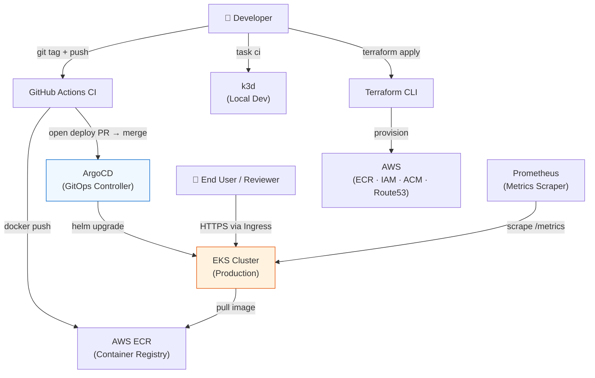
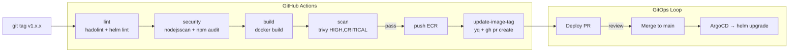
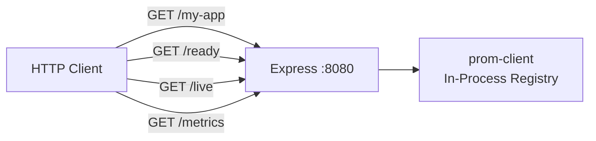
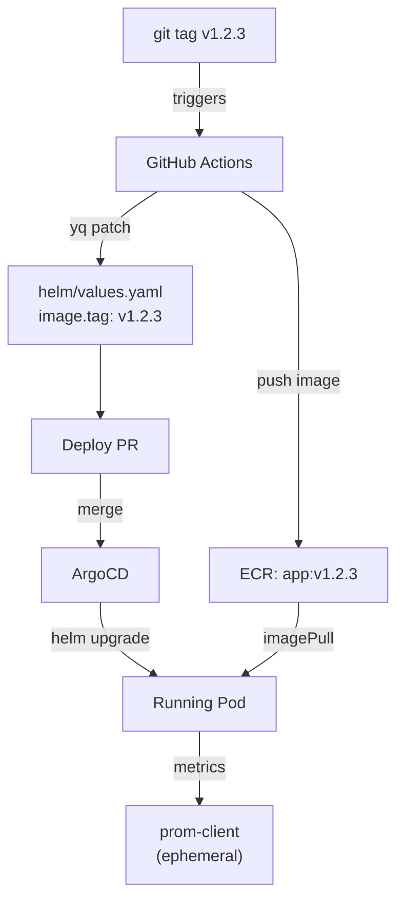
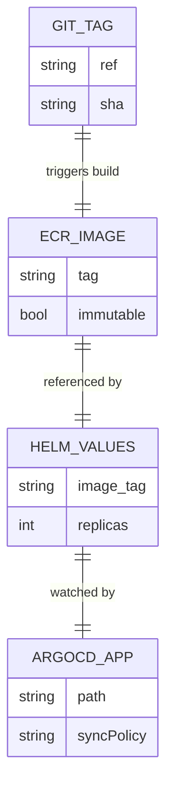
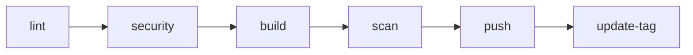
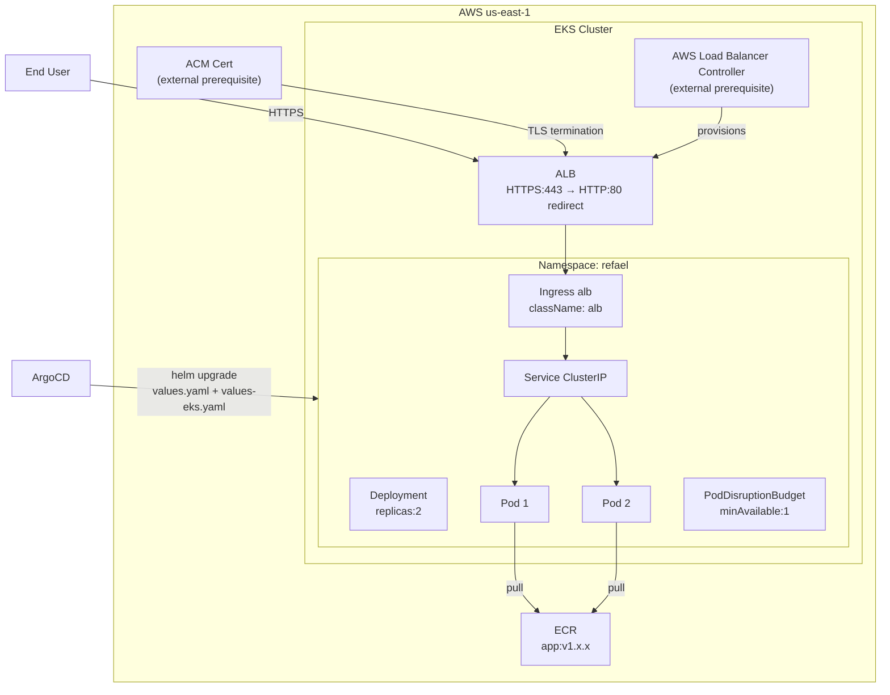
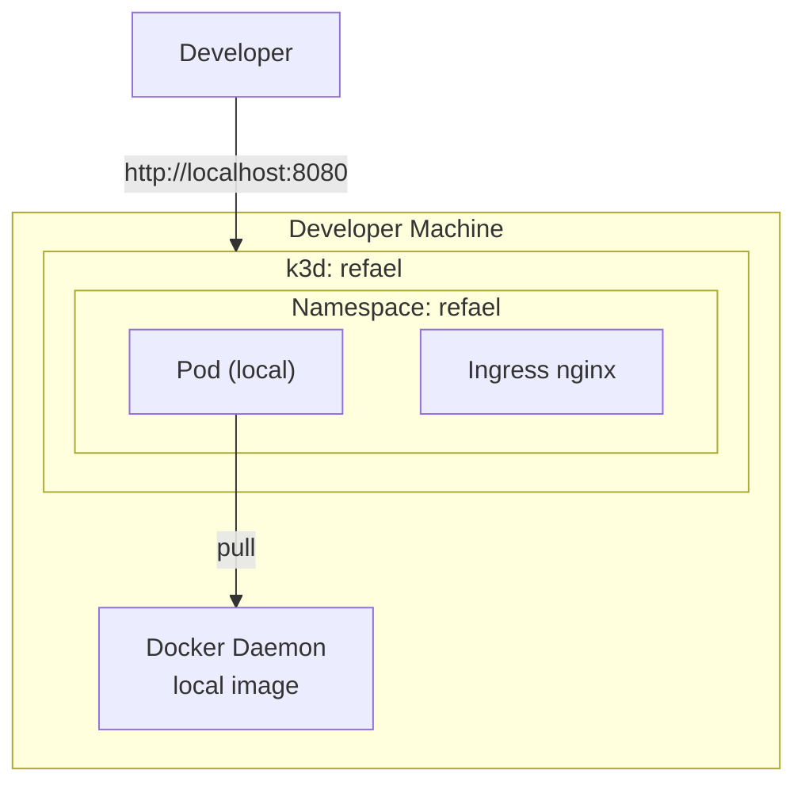

# Architecture Description: Refael App

## 1. Document Information

| Field | Value |
|-------|-------|
| Project | Refael Home Assignment — DevOps/DevSecOps |
| Version | v1.0.0 |
| Date | 2026-11-19 |
| Author | Oren Sultan |
| Status | Accepted |
| ADR Count | 16 Accepted |
| Generated by | `/architect-implement` |

---

## 2. Architectural Goals & Constraints

| Goal / Constraint | Source |
|------------------|--------|
| Production-grade CI/CD pipeline with SAST + image scanning | Assignment brief |
| Stateless app — Deployment not StatefulSet | ADR-001 |
| GitOps: same-repo approach, ArgoCD watches `helm/` | ADR-005 |
| No long-lived AWS credentials in CI | ADR-011 (OIDC) |
| Image immutability: semver tags only | ADR-010 |
| Block on HIGH+ image CVEs | ADR-007 |
| k3d uses nginx-ingress (HTTP); EKS uses ALB Ingress class (ACM/HTTPS) — parity intentionally reduced | ADR-009, ADR-016 |
| AWS Load Balancer Controller + validated ACM cert are manual EKS prerequisites (not in Terraform) | ADR-016, ChDR-002 |

---

## 3. Architectural Views

### 3.1 Context View

The Refael App is a stateless Node.js/Express HTTP service deployed to Kubernetes (EKS in production, k3d locally) via a GitOps pipeline managed by ArgoCD. Developer pushes a semver git tag to trigger the full CI/CD pipeline.



**External Entities**: Developer, End User/Reviewer, GitHub Actions, AWS ECR, ArgoCD, EKS, k3d, Prometheus, Terraform CLI, AWS (ECR/IAM/ACM/Route53)

### 3.2 Functional View

#### Functional Elements

| Element | Responsibility |
|---------|---------------|
| Express HTTP Server | Handles all HTTP requests on configurable `PORT` (default 8080) |
| Route Handlers | `/my-app`, `/about`, `/ready`, `/live`, `/classified`, `/metrics` |
| Prometheus Metrics Collector | In-process `prom-client`; `root_access_total` counter; default metrics |
| GitHub Actions Pipeline | lint → security → build → scan → push → update-image-tag |
| SAST Gate | nodejsscan + `npm audit --audit-level=high` |
| Trivy Scan Gate | Blocks on `HIGH,CRITICAL` unfixed CVEs before ECR push |
| Hadolint + Helm Lint | Dockerfile + chart validation before build |
| Image Tag Update Job | `yq` patches `values.yaml`; `gh pr create` opens deploy PR |
| ArgoCD Sync | Watches `helm/`; auto-syncs on PR merge |
| Helm Chart | Deployment, Service, Ingress, ConfigMap, PDB for the app |

#### CI/CD Pipeline



#### Application Routes



### 3.3 Information View

#### Data Entities

| Entity | Persistence | Owner |
|--------|------------|-------|
| HTTP Request/Response | None (stateless) | Express |
| Prometheus Metrics | Process lifetime only | prom-client |
| Docker Image | Immutable, semver tag in ECR | AWS ECR |
| `helm/values.yaml` | Git history | Repo |
| Git Tag | Permanent SCM ref | GitHub |
| Terraform State | Operator-managed | Local / S3 |

#### Configuration & Image Data Flow



#### Versioning Model



### 3.4 Development View

#### Repository Structure

```text
refael/
├── app.js                    # Express application (single file)
├── package.json
├── Dockerfile
├── Taskfile.yml              # Local dev runner (go-task)
├── helm/                     # Helm chart (ArgoCD target)
│   ├── Chart.yaml
│   ├── values.yaml
│   └── templates/
│       ├── deployment.yaml
│       ├── service.yaml
│       ├── ingress.yaml
│       ├── configmap.yaml
│       └── _helpers.tpl
├── terraform/                # AWS infra (ECR, IAM, ACM)
│   ├── main.tf
│   ├── variables.tf
│   └── outputs.tf
└── .github/workflows/
    └── ci.yml                # GitHub Actions pipeline
```

#### Technology Stack

| Layer | Technology |
|-------|-----------|
| Runtime | Node.js LTS / Express ^4.21.2 |
| Metrics | prom-client ^15.1.3 |
| Container | Docker (node:alpine base) |
| CI | GitHub Actions |
| SAST | nodejsscan + npm audit |
| Image Scan | Trivy (aquasecurity/trivy-action) |
| Lint | Hadolint v3.1.0 |
| K8s Package | Helm v3 |
| GitOps | ArgoCD |
| Local Runner | go-task (Taskfile) |
| IaC | Terraform ~>1.5 |

#### CI/CD Job Dependencies



### 3.5 Deployment View

#### Production Topology (EKS)



#### Local Dev Topology (k3d)



#### Helm Chart Key Configuration

| Resource | Config |
|----------|--------|
| Deployment | `replicas:2`, `rollingUpdate` (maxSurge:1, maxUnavailable:0) |
| readinessProbe | `GET /ready`, delay:5s, period:10s |
| livenessProbe | `GET /live`, delay:15s, period:20s |
| resources | requests: `100m/128Mi`, limits: `250m/256Mi` |
| securityContext | `runAsNonRoot`, `readOnlyRootFilesystem`, `drop:[ALL]` |
| Ingress | `className:nginx` (k3d/local); `className:alb` (EKS, TLS via ACM ARN) |
| PDB | `minAvailable:1` |
| preStop | `sleep 5` (graceful drain) |

#### Terraform-Provisioned AWS Resources

| Resource | Purpose |
|----------|---------|
| `aws_ecr_repository.app` | Private registry |
| `aws_iam_openid_connect_provider.github` | GitHub OIDC trust |
| `aws_iam_role.github_actions` | CI push role |

---

## 4. Architectural Perspectives

### 4.1 Security Perspective

| Concern | Mitigation | ADR |
|---------|-----------|-----|
| Vulnerable code | nodejsscan (OWASP Top 10) + npm audit | ADR-006 |
| Vulnerable image | Trivy HIGH,CRITICAL gate pre-push | ADR-007 |
| Dockerfile misconfig | Hadolint in CI | ADR-012 |
| Long-lived AWS creds in CI | GitHub OIDC → assume role | ADR-011 |
| ECR credential in cluster | EKS node IAM role (no imagePullSecrets) | ADR-004 |
| HTTPS enforcement | ALB terminates TLS via ACM cert (EKS); HTTP locally (k3d) | ADR-016, ADR-009 |
| Non-root container | `runAsNonRoot: true` in securityContext | ADR-009 |
| Read-only container FS | `readOnlyRootFilesystem: true` | ADR-009 |
| Capability escalation | `drop: [ALL]` in securityContext | ADR-009 |
| Deploy audit trail | Every deploy = merged PR in Git history | ADR-008 |

### 4.2 Performance & Scalability Perspective

| Concern | Approach | ADR |
|---------|---------|-----|
| Horizontal scale | `replicas:2` minimum; HPA on CPU>70% | ADR-001 |
| Zero-downtime deploy | `rollingUpdate` + PDB `minAvailable:1` | ADR-009 |
| Image pull latency | `imagePullPolicy: IfNotPresent` (node cache) | ADR-004 |
| Graceful shutdown | `preStop: sleep 5` before SIGTERM | ADR-009 |
| Resource isolation | CPU/mem limits on all pods | ADR-001 |
| CI scan latency | Trivy DB cached via `cache-dir` in Actions | ADR-007 |

---

## 5. Architecture Decision Records Summary

Full ADR index: [docs/adlc/memory/adr/adr.md](../memory/adr/adr.md)

| ID | Sub-System | Decision |
|----|-----------|---------|
| ADR-001 | System | Node.js Express Stateless Monolith → Deployment |
| ADR-002 | System | Prometheus Metrics In-Process (prom-client) |
| ADR-003 | CI/CD | GitHub Actions as CI/CD Engine |
| ADR-004 | Deployment | AWS ECR as Container Registry |
| ADR-005 | Deployment | Same-Repo GitOps with ArgoCD |
| ADR-006 | CI/CD | SAST: nodejsscan + npm audit |
| ADR-007 | CI/CD | Trivy Image Scan Gate: HIGH+ignore-unfixed |
| ADR-008 | CI/CD | CI Opens PR for Image Tag Update |
| ADR-009 | Deployment | EKS (prod) + k3d (local) + nginx-ingress |
| ADR-010 | CI/CD | Semantic Versioning + Git Tags |
| ADR-011 | Deployment | Terraform for AWS Infrastructure |
| ADR-012 | CI/CD | Bonus: Hadolint + Helm Lint in CI |
| ADR-013 | Development | Local Dev Task Runner: Taskfile (go-task) |
| ADR-014 | CI/CD | CI Routing by Changed Paths and Branch |
| ADR-015 | CI/CD | Terraform Plan in the PR Gate via OIDC Read Policy |
| ADR-016 | Deployment | EKS ALB Ingress with ACM Certificate; nginx for k3d |

---

## 6. Tech Stack Summary

| Category | Technology | Notes |
|----------|-----------|-------|
| Application | Node.js + Express | Stateless, single file |
| Metrics | prom-client | In-process Prometheus |
| Container | Docker (node:alpine) | Multi-stage build |
| CI/CD | GitHub Actions | Tag-triggered pipeline |
| Registry | AWS ECR | Immutable tags |
| K8s Package | Helm v3 | Same chart for prod+local |
| GitOps | ArgoCD | Same-repo, watches `helm/` |
| Prod Cluster | EKS (us-east-1) | ALB Ingress (AWS Load Balancer Controller) + ACM TLS |
| Local Cluster | k3d | nginx-ingress, HTTP, port 8080 |
| IaC | Terraform | ECR, IAM, OIDC, EKS (ACM/R53 are manual prerequisites) |
| Local Runner | go-task (Taskfile) | Full local CI replication |
| SAST | nodejsscan + npm audit | OWASP Top 10 + SCA |
| Image Scan | Trivy | HIGH,CRITICAL gate |
| Lint | Hadolint + helm lint | Dockerfile + chart |
