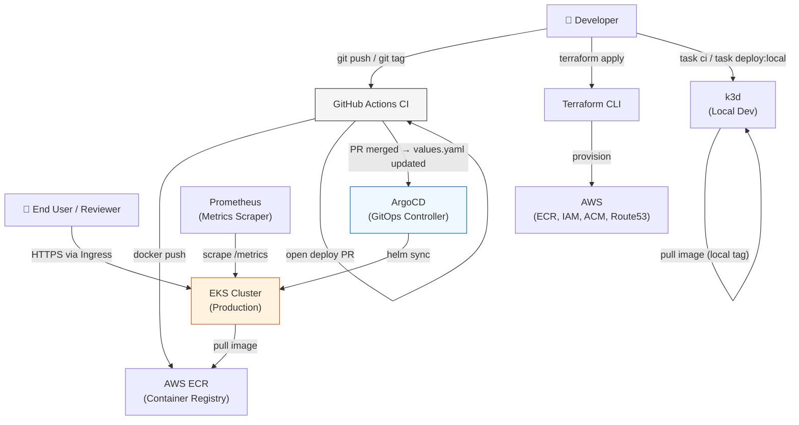

# Context View — Refael App

> ADRs: ADR-001, ADR-002, ADR-004, ADR-005, ADR-009, ADR-011
> Date: 2026-11-19

## System Scope

The **Refael App** is a stateless Node.js/Express HTTP service that exposes application endpoints and Prometheus metrics. It is deployed to Kubernetes (EKS in production, k3d locally) via a GitOps pipeline managed by ArgoCD. The system boundary includes the application code, its Docker image in AWS ECR, the Helm chart, and the GitHub Actions CI/CD pipeline.

## External Entities

| Entity | Type | Interaction | Direction |
|--------|------|------------|-----------|
| Developer | Human | Push code / git tag / PR review | In |
| GitHub Actions CI | External system | Build, scan, push image, open deploy PR | Bidirectional |
| AWS ECR | External system | Store and serve Docker images | Out (push) / In (pull) |
| ArgoCD | External system | Pull Helm values, sync to cluster | In (watches repo) |
| EKS Cluster | External system | Hosts running pods, Ingress | Out (deploy) |
| k3d (local) | External system | Local cluster for dev/test | Out (deploy) |
| Prometheus / Scraper | External system | Scrapes `/metrics` endpoint | In |
| End User / Reviewer | Human | HTTP requests via Ingress URL | In |
| Terraform CLI | External tool | Provisions ECR, IAM, ACM on AWS | Out |
| AWS Route53 / ACM | External system | DNS + TLS certificate for Ingress | Out |

## Context Diagram

## External Dependencies

| Dependency | Purpose | ADR Reference |
|-----------|---------|--------------|
| AWS ECR (us-east-1, assignment-tests) | Private image registry | ADR-004 |
| GitHub Actions | CI/CD runtime | ADR-003 |
| ArgoCD | GitOps reconciler | ADR-005 |
| EKS (pre-existing) | Production K8s cluster | ADR-009 |
| k3d | Local K8s cluster | ADR-009 |
| Terraform (assignment-tests profile) | AWS infra provisioning | ADR-011 |
| nginx-ingress | HTTP routing on both clusters | ADR-009 |

## Security Perspective (Context Level)

- All external traffic enters via HTTPS (ACM cert + nginx-ingress annotation)
- GitHub Actions uses OIDC (no long-lived AWS credentials) — ADR-011
- EKS nodes use IAM role for ECR pull (no imagePullSecrets) — ADR-004
- Developer pushes trigger CI only on tag push (`v*`) — ADR-010
