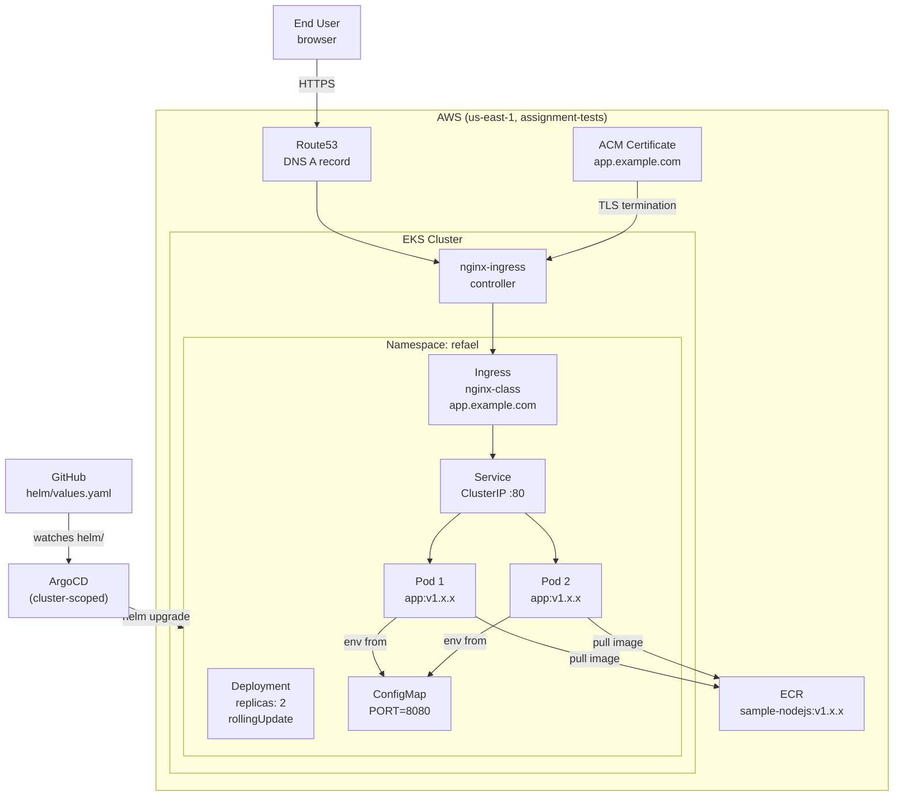
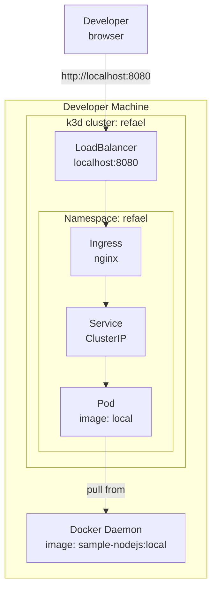

# Deployment View — Refael App

> ADRs: ADR-004, ADR-005, ADR-009, ADR-010, ADR-011
> Date: 2026-11-19
> Dependencies: development.md

## Runtime Environments

| Environment | Cluster | Registry | Namespace | Trigger |
|-------------|---------|---------|-----------|---------|
| Production | EKS (us-east-1, assignment-tests) | AWS ECR | `refael` | ArgoCD on PR merge |
| Local Dev | k3d (single-node) | Local daemon | `refael` | `task deploy:local` |

## Deployment Topology

## Local Dev Topology

## Helm Chart Configuration

| Resource | Key Config |
|----------|-----------|
| `Deployment` | `replicas: 2`, `strategy: RollingUpdate` (maxSurge:1, maxUnavailable:0) |
| `readinessProbe` | `GET /ready`, initialDelaySeconds: 5, periodSeconds: 10 |
| `livenessProbe` | `GET /live`, initialDelaySeconds: 15, periodSeconds: 20 |
| `resources.requests` | `cpu: 100m`, `memory: 128Mi` |
| `resources.limits` | `cpu: 250m`, `memory: 256Mi` |
| `securityContext` | `runAsNonRoot: true`, `readOnlyRootFilesystem: true`, `drop: [ALL]` |
| `Service` | `type: ClusterIP`, `port: 80`, `targetPort: 8080` |
| `Ingress` | `className: nginx`, `tls: true` (ACM cert ARN annotation) |
| `ConfigMap` | `PORT: "8080"`, app-level non-secret config |
| `PodDisruptionBudget` | `minAvailable: 1` (zero-downtime maintenance) |
| `preStop hook` | `sleep 5` (graceful connection drain before SIGTERM) |

## Terraform-Provisioned Resources

| Resource | Purpose |
|----------|---------|
| `aws_ecr_repository.app` | Private registry `sample-nodejs` |
| `aws_iam_openid_connect_provider.github` | GitHub OIDC trust |
| `aws_iam_role.github_actions` | CI push role |
| `aws_iam_role_policy.ecr_push` | ECR push permissions |
| `aws_iam_role_policy_attachment.node_ecr_pull` | EKS node ECR pull |
| `aws_acm_certificate.ingress` | TLS cert for app domain |
| `aws_route53_record.cert_validation` | DNS validation record |

## Security Perspective (Deployment Level)

- HTTPS enforced at nginx-ingress via ACM cert (ADR-011)
- EKS node IAM role for ECR pull — no imagePullSecrets in cluster (ADR-004)
- GitHub Actions OIDC — no long-lived AWS credentials in GitHub Secrets (ADR-011)
- `runAsNonRoot`, `readOnlyRootFilesystem`, `drop ALL` caps in pod securityContext
- NetworkPolicy: restrict pod egress to cluster DNS only (future hardening)

## Performance Perspective (Deployment Level)

- `replicas: 2` minimum for HA; HPA can scale on CPU > 70%
- `imagePullPolicy: IfNotPresent` — node-cached images, no re-pull on restart
- nginx-ingress keepalive + upstream connection reuse
- `PodDisruptionBudget minAvailable: 1` prevents all pods being evicted simultaneously
