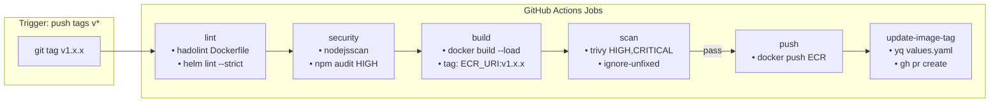
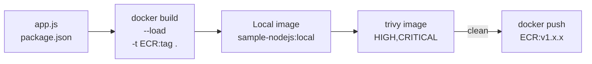
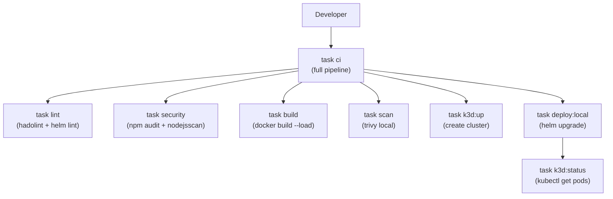

# Development View — Refael App

> ADRs: ADR-001, ADR-003, ADR-006, ADR-007, ADR-008, ADR-010, ADR-012
> Date: 2026-11-19
> Dependencies: functional.md

## Code Organization

```text
refael/
├── app.js                          # Express application (single file)
├── package.json                    # Node.js dependencies
├── package-lock.json
├── Dockerfile                      # Multi-stage build (node:alpine)
├── Taskfile.yml                    # Local dev task runner (go-task)
│
├── helm/                           # Helm chart (ArgoCD watches this path)
│   ├── Chart.yaml
│   ├── values.yaml                 # image.tag updated by CI deploy PR
│   └── templates/
│       ├── deployment.yaml
│       ├── service.yaml
│       ├── ingress.yaml
│       ├── configmap.yaml
│       ├── hpa.yaml
│       └── _helpers.tpl
│
├── terraform/                      # AWS infrastructure provisioning
│   ├── main.tf                     # ECR, OIDC, IAM, ACM, Route53
│   ├── variables.tf
│   └── outputs.tf
│
├── .github/
│   └── workflows/
│       └── ci.yml                  # GitHub Actions pipeline
│
├── docs/
│   └── adlc/
│       ├── architect/
│       │   ├── AD.md               # Architecture Description (generated)
│       │   └── views/              # Per-view architecture files
│       └── memory/
│           └── adr/                # Accepted ADRs (canonical)
│
└── .adlc/
    ├── drafts/adr/                 # ADR drafts (pre-acceptance)
    └── architect/state.json        # implement workflow state
```

## CI/CD Pipeline Jobs



## Technology Stack

| Layer | Technology | Version |
|-------|-----------|---------|
| Runtime | Node.js | LTS (from base image) |
| Framework | Express | ^4.21.2 |
| Metrics | prom-client | ^15.1.3 |
| Container base | node:alpine | pinned in Dockerfile |
| CI/CD | GitHub Actions | - |
| SAST | nodejsscan | latest |
| SCA | npm audit | built-in |
| Image scan | Trivy (aquasecurity/trivy-action) | v0.x pinned |
| Dockerfile lint | Hadolint (hadolint/hadolint-action) | v3.1.0 |
| K8s package manager | Helm | v3 |
| GitOps | ArgoCD | cluster-managed |
| Local runner | go-task (Taskfile) | latest |
| IaC | Terraform | ~>1.5 |

## Build Process



## Local Development Workflow



## Security Perspective (Development Level)

- Dockerfile uses non-root user (`USER node`) — ADR-012 / sympera reference
- `readOnlyRootFilesystem: true` in Helm security context
- `runAsNonRoot: true`, `drop: [ALL]` capabilities in securityContext
- `npm audit --audit-level=high` blocks on HIGH+ SCA findings — ADR-006
- nodejsscan catches OWASP Top 10 patterns pre-build — ADR-006
- Trivy blocks HIGH+ image CVEs pre-push — ADR-007

## Performance Perspective (Development Level)

- Trivy DB cached via `cache-dir` in GitHub Actions to reduce scan time
- Multi-stage Dockerfile (build stage + runtime stage) minimizes image size
- `npm ci` (not `npm install`) for reproducible, faster installs in CI
