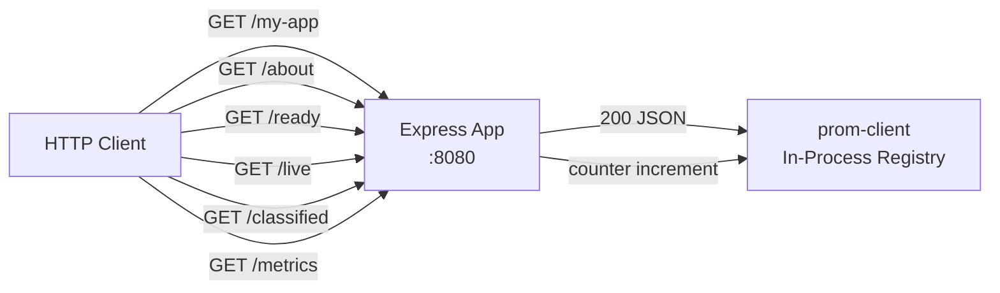

# Functional View — Refael App

> ADRs: ADR-001, ADR-002, ADR-003, ADR-005, ADR-006, ADR-007, ADR-008, ADR-010, ADR-012
> Date: 2026-11-19
> Dependency: context.md

## Functional Elements

| Element | Responsibility | ADR |
|---------|---------------|-----|
| **Express HTTP Server** | Handles all inbound HTTP requests; routes to handlers | ADR-001 |
| **Route Handlers** | `/my-app` (main), `/about`, `/ready`, `/live`, `/classified`, `/metrics` | ADR-001 |
| **Health Probe Handlers** | `/ready` and `/live` return 200 OK; used by K8s probes | ADR-001 |
| **Prometheus Metrics Collector** | In-process `prom-client` registry; `collectDefaultMetrics()`; `root_access_total` counter | ADR-002 |
| **GitHub Actions Pipeline** | `on: push: tags: ["v*"]`; jobs: lint → security → build → scan → push → update-image-tag | ADR-003, ADR-010 |
| **SAST Gate** | nodejsscan + `npm audit --audit-level=high`; fail on critical findings | ADR-006 |
| **Trivy Scan Gate** | Scan local image; block on `HIGH,CRITICAL` unfixed CVEs | ADR-007 |
| **Hadolint Lint Gate** | Lint Dockerfile for best-practice violations | ADR-012 |
| **Helm Lint Gate** | `helm lint helm/ --strict` before deploy | ADR-012 |
| **Image Tag Update Job** | `yq` patches `helm/values.yaml`; `gh pr create` opens deploy PR | ADR-008 |
| **ArgoCD Sync** | Watches `helm/` path; auto-syncs on PR merge to main | ADR-005 |
| **Helm Chart** | Deployment, Service, Ingress, ConfigMap, HPA (optional) for the app | ADR-001, ADR-009 |
| **Taskfile Runner** | Local `task ci` / `task lint` / `task k3d:up` orchestration | (ADR-013 proposed) |

## CI/CD Pipeline Flow

```mermaid
flowchart LR
    Tag["git tag v1.x.x\ngit push --tags"]

    subgraph CI ["GitHub Actions Pipeline"]
        Lint["lint\nhadolint + helm lint"]
        SAST["security\nnodejsscan + npm audit"]
        Build["build\ndocker build --load"]
        Scan["scan\ntrivy HIGH,CRITICAL"]
        Push["push\ndocker push ECR"]
        UpdateTag["update-image-tag\nyq + gh pr create"]
    end

    subgraph GitOps ["GitOps Loop"]
        PR["Deploy PR\nchore: deploy v1.x.x"]
        Merge["Merge to main"]
        Argo["ArgoCD sync\nhelm upgrade"]
    end

    Tag --> Lint
    Lint --> SAST
    SAST --> Build
    Build --> Scan
    Scan -->|"pass"| Push
    Push --> UpdateTag
    UpdateTag --> PR
    PR -->|"human review"| Merge
    Merge --> Argo
```

## Application Route Map

## Functional Boundaries

- **App boundary**: single `app.js`; no worker threads, no child processes
- **Metrics boundary**: in-process `prom-client`; no external push-gateway
- **Pipeline boundary**: GitHub-hosted runners; no self-hosted agents
- **Deploy boundary**: ArgoCD owns cluster state; CI only updates `values.yaml`

## Security Perspective (Functional Level)

- SAST gate (ADR-006): code-level OWASP Top 10 patterns caught before image build
- Trivy gate (ADR-007): image CVEs blocked before ECR push — no vulnerable image reaches cluster
- `/classified` route exists in app; consider NetworkPolicy or auth middleware before prod
- Pipeline uses `GITHUB_TOKEN` for PR creation (no extra secret); ECR push via OIDC role (ADR-011)

## Performance Perspective (Functional Level)

- Stateless Express: scales horizontally via Deployment replicas — ADR-001
- `collectDefaultMetrics()` adds ~1ms overhead per scrape interval; negligible
- No database or external state → no connection pool bottleneck
- Port configurable via `PORT` env var; default 8080
