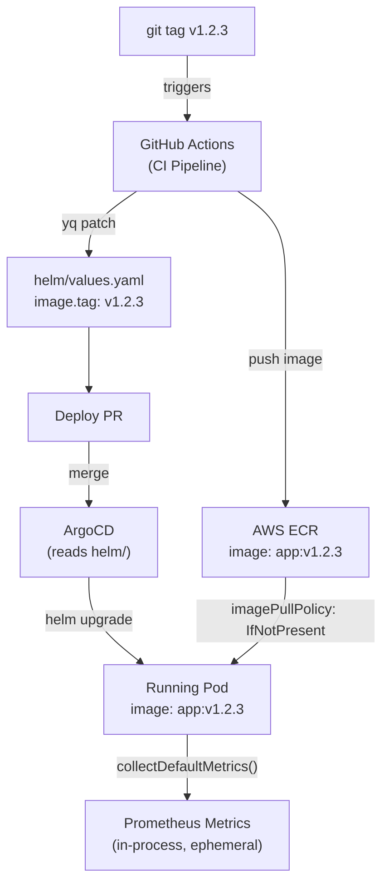
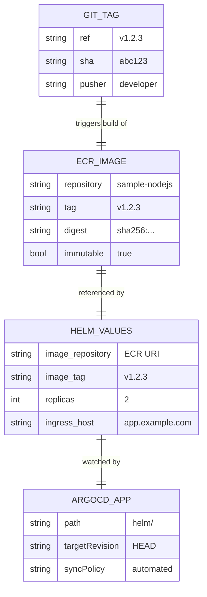

# Information View — Refael App

> ADRs: ADR-001, ADR-002, ADR-005, ADR-008, ADR-010
> Date: 2026-11-19
> Dependencies: context.md, functional.md

## Data Entities

| Entity | Type | Owner | Persistence | ADR |
|--------|------|-------|------------|-----|
| HTTP Request/Response | Transient | Express | None (stateless) | ADR-001 |
| Prometheus Metrics | In-memory | prom-client registry | Process lifetime only | ADR-002 |
| Docker Image | Artifact | AWS ECR | Immutable, tagged by semver | ADR-004, ADR-010 |
| `helm/values.yaml` | Config file | Git repo | Git history | ADR-005, ADR-008 |
| Git Tag (`v1.x.x`) | SCM ref | GitHub repo | Permanent | ADR-010 |
| Terraform State | State file | Local / S3 | Persistent (operator-managed) | ADR-011 |
| CI Workflow Run | Log | GitHub Actions | 90-day GitHub retention | ADR-003 |

## Configuration Data Flow

## Image Versioning Model

## Data Quality & Immutability

- ECR repo configured with **image tag immutability** — once `v1.2.3` is pushed, it cannot be overwritten
- `helm/values.yaml` changes tracked in Git — full audit trail of every deploy
- No application-level database — zero schema migration risk
- Metrics are ephemeral: pod restart resets all counters (by design for Prometheus pull model)

## Security Perspective (Information Level)

- No PII or secrets stored in `values.yaml` — Kubernetes Secrets used for sensitive config
- Terraform state may contain sensitive ARNs — store in S3 with encryption + versioning for production
- ECR image scanning (ADR-007) produces vulnerability reports — stored as CI artifacts
